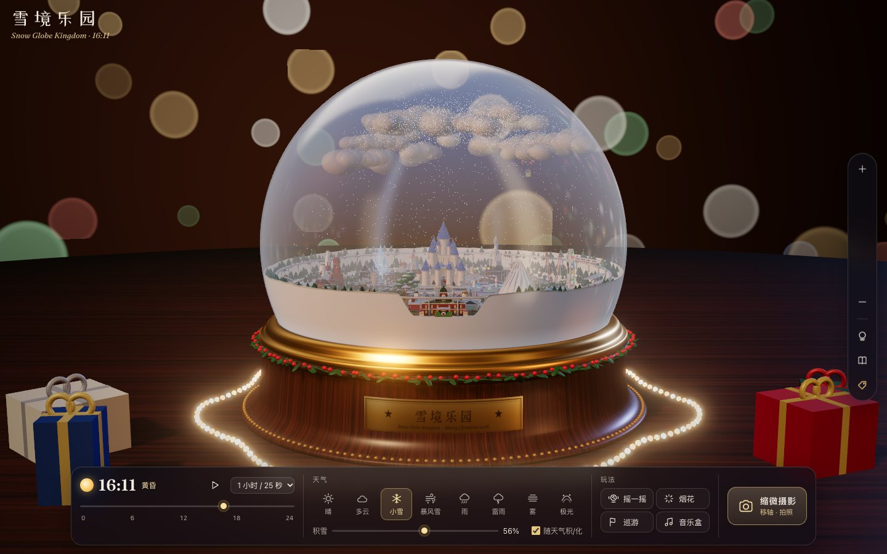
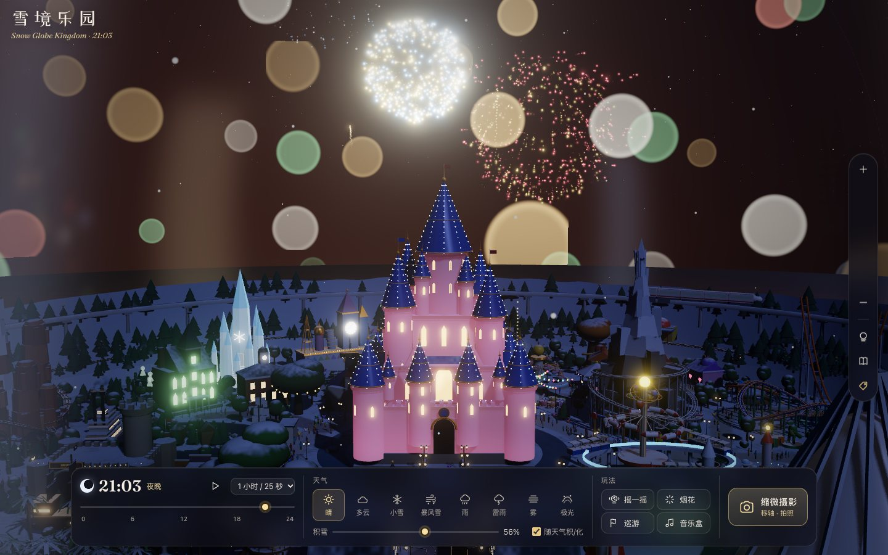
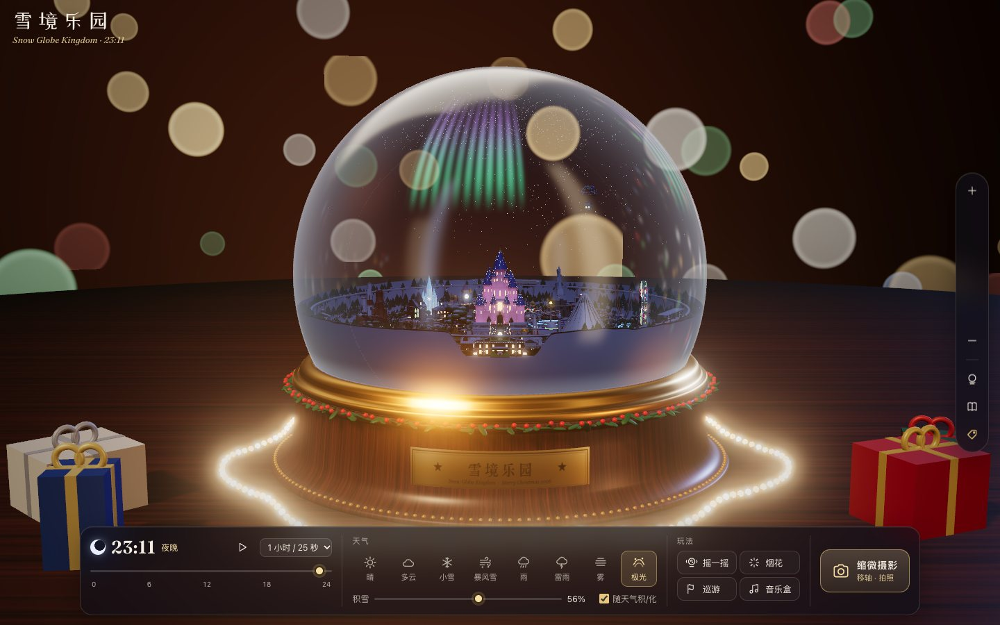
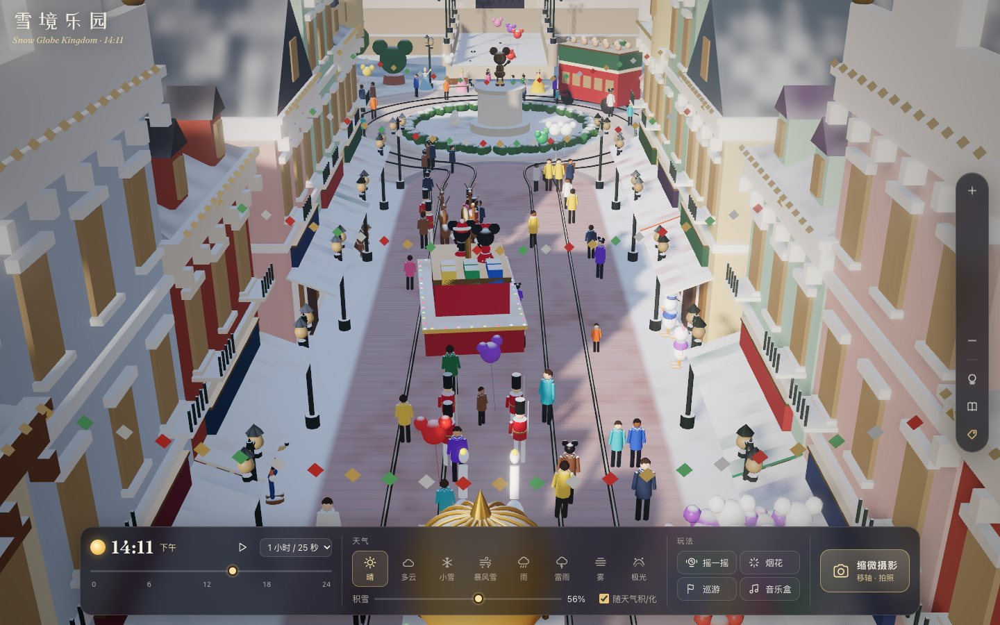
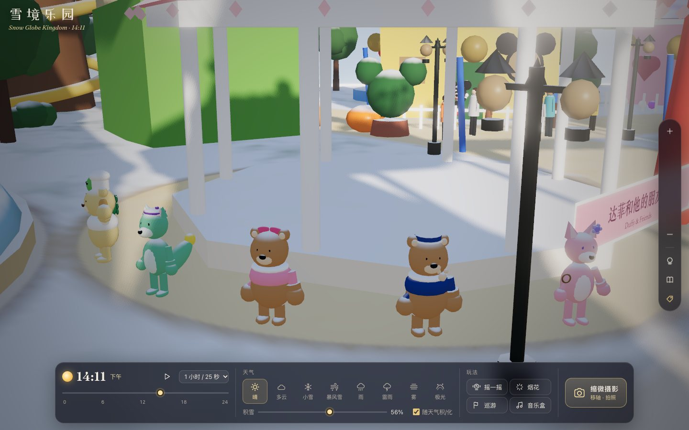
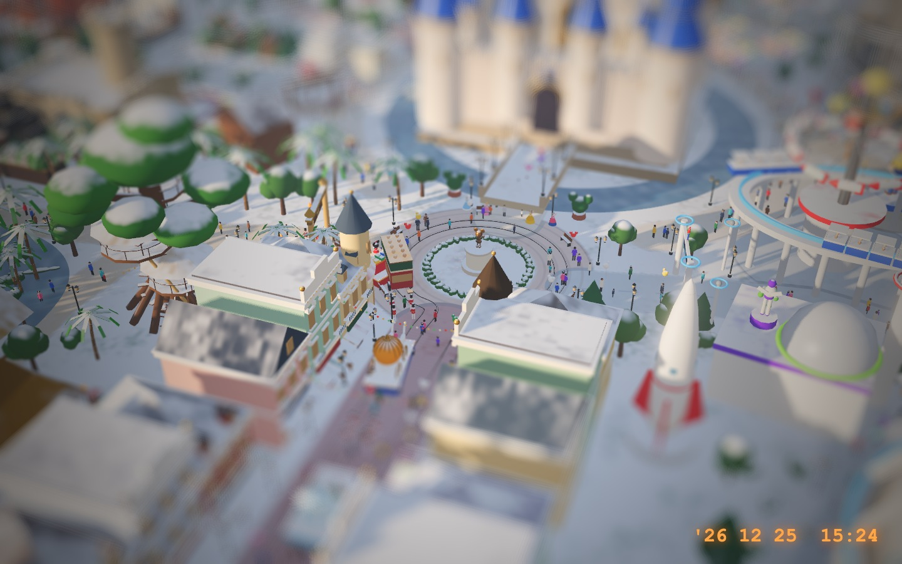

# 雪境乐园 · Snow Globe Kingdom

一个装在圣诞玻璃球里的 3D 主题乐园。天气、昼夜都能用界面控制，可以从桌上的整个雪景球无级缩放到游客视角，还能切到缩微（移轴）模式拍照。纯 JavaScript + [three.js](https://threejs.org/)，构建后是一个可以离线打开的单文件 HTML 页面。

**在线体验：https://leoli-dev.github.io/snowglobe-park/**



| | |
| --- | --- |
|  |  |
|  |  |



## 这个项目是怎么来的

整个仓库由 **Claude Opus 5.5**（thinking level：**max**）根据下面这一段 prompt 生成。代码、程序化建模和调试都由模型完成；模型还在无头浏览器里截图检查画面，再自己修正。

```
用 js 来构建一个 3D 圣诞玻璃球
玻璃球里面的天气状况可以通过UI控制，昼夜光阴也可以控制
玻璃球内有一个完整的迪士尼乐园，可以无级放大缩小观察，可以进入缩微模式拍照
迪士尼乐园该有的项目、人物一个不能少
做好了给我一个可以看的link
```

## 功能

- **雪景球**：玻璃有菲涅尔反射，底座是胡桃木音乐盒，配黄铜铭牌、冬青花环，桌上有灯串和礼物，背景是散景灯光。
- **天气**：晴、多云、小雪、暴风雪、雨、雷雨（有闪电和雷声）、雾、极光。积雪量可以手动调，也可以随天气慢慢积起来或融化，屋顶和地面会跟着变白。下雨时地面变得湿亮。
- **摇一摇**：雪花和亮片在球里旋转，再像在水里一样慢慢落下。
- **昼夜**：时间轴可以拖，也可以让时间自己流逝。太阳和月亮按冬季轨迹运行，夜里会出现星星。日落后窗户、灯串和城堡投影灯会亮起来。
- **演出**：14:00 和 19:30 有圣诞巡游，共 8 辆花车，夜里花车挂满彩灯；21:00 有城堡烟花，烟花里有米奇头、爱心、垂柳、十字分裂等造型。
- **无级缩放**：滚轮、双指或右侧滑杆都能缩放，会朝光标所指的位置推进。双击地面飞过去；在图鉴里点名字可以飞到对应景点，或跟随火车、单轨这类移动的东西。
- **缩微摄影**：移轴镜头模糊，对焦带可以拖动，色彩和对比度更强，小世界加速运转。有 3 秒自拍、胶片日期印、相册，照片可以保存。
- **音乐盒**：用 WebAudio 实时合成公有领域的圣诞曲：Jingle Bells、We Wish You a Merry Christmas、Silent Night。
- **图鉴与标签**：60 个景点条目和 82 个人物条目，可以搜索。镜头靠近时会显示名称标签。

## 乐园里有什么

| 园区 | 项目 |
| --- | --- |
| 城堡 | 童话城堡（夜间投影灯与冰晶灯串）、护城河与石桥 |
| 美国小镇大街 | 维多利亚街屋、小镇广场圣诞树、火车站、米奇花坛、马拉有轨电车与双层巴士、米奇铜像、气球小贩 |
| 探险世界 | 瑞士家庭树屋、魔幻提基屋、丛林巡航（大象、河马、瀑布）、荣耀石、夺宝奇兵神庙、阿拉丁飞毯、加勒比海盗 |
| 边域世界 · 自由广场 | 巨雷山矿山车、飞溅山、美国河上的马克·吐温号与帆船、汤姆·索亚岛、乡村熊剧场、幽灵公馆（夜里有幽灵）、自由之树、总统堂 |
| 梦幻世界 | 白马王子旋转木马、疯帽子旋转茶杯、小飞象、小飞侠天空奇遇、小小世界、七个小矮人矿山车、维尼蜂蜜罐、长发公主之塔、爱丽丝迷宫、艾莎冰宫、马特洪峰雪橇 |
| 米奇卡通城 | 米奇的家、米妮的家、高飞游乐屋、奇奇蒂蒂树屋、唐老鸭的船、橡果过山车、达菲和朋友们的凉亭 |
| 玩具总动员乐园 | 弹簧狗过山车、三眼仔旋转飞碟、RC 赛车、巨型胡迪、巨型抱抱龙、积木与蜡笔 |
| 明日世界 | 太空山、创极速光轮、宇宙飞行器、明日世界飞跃车、巴斯光年星际营救、月球火箭、明日世界赛车场（含闪电麦昆）、米奇脸摩天轮 |
| 环园与天空 | 蒸汽火车（三站停靠）、单轨列车、飞屋环游记的气球屋 |

**人物**：米奇（含圣诞造型）、米妮、唐老鸭、黛丝、高飞、布鲁托、奇奇、蒂蒂；灰姑娘、白雪公主、爱洛、贝儿、爱丽儿、茉莉、乐佩、花木兰、蒂安娜、莫阿娜、梅莉达、宝嘉康蒂、艾莎、安娜、雪宝、斯文；七个小矮人、彼得潘、小叮当、虎克船长、杰克船长、爱丽丝、疯帽子、柴郡猫、匹诺曹、阿拉丁、精灵、辛巴；维尼、跳跳虎、皮杰、屹耳；达菲、雪莉玫、玲娜贝儿、星黛露、杰拉多尼、可琦安、奥乐米拉；胡迪、翠丝、红心、巴斯光年、抱抱龙、三眼仔、草莓熊、大眼仔、毛怪、瓦力、伊娃；史迪奇、大白、朱迪、尼克、玛丽猫；达斯·维达、帝国白兵、R2-D2、BB-8、蜘蛛侠、钢铁侠。园区里还有约 780 位游客，有的戴米奇耳朵，有的拿着米奇气球。

## 操作

| 操作 | 方式 |
| --- | --- |
| 旋转 | 左键拖拽 / 单指拖动 |
| 缩放 | 滚轮 / 双指捏合 / 右侧滑杆 |
| 平移 | 右键拖拽，或按住 Shift 拖拽 |
| 飞到某处 | 双击地面，或在图鉴里点名字 |
| 快捷键 | 空格：摇一摇（缩微模式下是拍照）· F 烟花 · P 巡游 · M 缩微模式 · G 图鉴 · L 标签 · H 全景 · Esc 退出 |

## 本地运行

```bash
npm install
npm run build    # 输出 dist/index.html（单文件，JS/CSS 全部内联）
npm run serve    # http://localhost:5288/
```

也可以直接双击 `dist/index.html` 打开。字体从 Google Fonts 加载，没有网络时会回退到系统字体。

`dist/artifact.html` 是同一页面的片段版本，不带 `<html>`、`<head>`、`<body>`，给会自动包裹页面骨架的宿主用。

用无头浏览器截图（默认用 Thorium，可以用 `BROWSER_PATH` 指向任意 Chromium 系浏览器）：

```bash
node tools/shot.mjs '[{"name":"default","wait":4000}]' /tmp/shots 1280 800
npm run media    # 重新生成 README 里的配图
```

## 项目结构

```
src/
  core/    几何构建器（顶点色 + 按材质合并）、共享材质与着色器补丁、文字招牌
  env/     房间与底座、玻璃、球内天空、昼夜与天气参数、地形
  park/    乐园布局和各园区、游乐设施（过山车轨道、跟随曲线的载具）、道具实例
  chars/   角色工具包、角色站位与动画、游客
  fx/      天气粒子、烟花、巡游、烟雾、后期（泛光、移轴、调色）
  ui/      相机控制、界面、名称标签、缩微摄影
  audio/   音乐盒与音效
tools/     截图、配图、几何统计、本地静态服务器
```

## 技术要点

- 所有模型都由代码用基础几何体拼成：几何体烘焙顶点色后按材质合并，整个乐园只要几次绘制调用；重复的东西（树、路灯、灯泡、游客、旋转杯等）都用实例化渲染。
- 积雪和湿润效果是对标准材质的着色器补丁：表面越朝上积雪越多，再叠一层噪声让积雪不均匀。夜间发光、城堡投影灯和水面反射也是同一套补丁。
- 雾只在玻璃球里生效：按视线在球内经过的长度计算，所以从球外看是一团雾，进到球里视野就慢慢变模糊。
- 渲染分三层：房间、球内世界、玻璃。玻璃用自定义的预乘菲涅尔着色器，镜头钻进球里时玻璃会淡出。
- 后期处理依次是泛光、色调映射、48 采样的盘形移轴模糊和调色。帧率不够时会自动降低分辨率。
- 雪、亮片、雨、烟花和烟雾都是在 CPU 上更新的粒子系统。

在 Apple M5 Max 上大约 60 fps，每帧约 230 万三角面（含阴影）。集成显卡会慢一些。

## 声明

这是非商业的粉丝致敬作品，与华特迪士尼公司（The Walt Disney Company）没有关系，也没有得到其授权或赞助。文中提到的角色名和项目名是各自权利人的商标。所有 3D 模型都是用代码从基础几何体程序化生成的原创造型，没有使用任何官方素材、Logo、音乐或图片；音乐盒的曲子都是公有领域的圣诞曲。

## License

源代码使用 [MIT](LICENSE) 许可。许可只覆盖本仓库的代码，不涉及任何第三方商标或角色形象。

---

## English

**Snow Globe Kingdom** is a 3D Christmas snow globe with a miniature theme park inside, written in plain JavaScript with three.js. You can change the weather (8 kinds, including snow accumulation and shaking the globe) and the time of day (parades at 14:00 and 19:30, castle fireworks at 21:00). You can zoom continuously from the whole globe on the table down to street level, and take tilt-shift "miniature" photos.

**Live demo: https://leoli-dev.github.io/snowglobe-park/**

**How it was made:** the whole repository was generated by **Claude Opus 5.5** (thinking level: **max**) from the single Chinese prompt quoted above. It asks for a 3D Christmas glass globe in JS, with UI-controlled weather and time of day, a complete Disney-style park inside with every attraction and character, stepless zoom, and a miniature photo mode. The model wrote all the code and did all the procedural modelling, then checked its own work by rendering screenshots in a headless browser.

Build with `npm install && npm run build`, then open `dist/index.html`.

This is a non-commercial fan tribute. It is not affiliated with, endorsed by or sponsored by The Walt Disney Company, and all models are original procedural geometry. The code is MIT-licensed; third-party trademarks and characters are not covered by the license.
